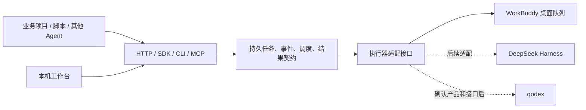

# Agent Hub 设计方案

设计日期：2026-10-11。目标：让任意项目、脚本和 Agent 方便地使用用户已有 Agent 账号的执行能力及可用额度。首期只接入 WorkBuddy；DeepSeek Harness、qodex 的具体接口及权益后续分别验证。

## 从目标推导边界

用户需要的是可用成果。衡量指标是接入步骤、人工干预、任务成功率、耗时、积分消耗，以及调用方自身模型的消耗。工作空间数量、聊天气泡数量不是成效指标。平台暴露的是 Agent 任务执行能力；没有证据时不声称提供任意模型的原始推理 API、无限免费额度或完整 OpenAI API 兼容。

账号、执行器、项目、任务、执行轮次是不同对象。账号决定权益；执行器决定模型、工具和运行环境；项目决定文件目录；任务决定目标；轮次决定一次具体尝试。多个项目可以共用一个账号的额度，但拥有各自的执行会话。新增工作空间不会增加额度。

上层只提交 provider、task、可选 workspace、output 和稳定的 idempotencyKey。平台负责排队、准备目录和会话、派工、收集事件和结果。纯文本任务未指定目录时，自动分配独立目录。业务项目指定目录后复用对应 WorkBuddy 会话；返工保留原任务和会话。

## 架构



保留现有 WorkBuddy MCP、TaskStore、原生会话管理和 LaunchAgent。新平台使用独立 SQLite 保存平台任务与事件，以稳定的底层 taskId 关联现有执行记录。现有播客项目和旧任务不迁移、不重新派发。

执行器接口统一为 descriptor、health、submit、poll、cancel、rework、accept。能力描述明确输出格式、目录隔离、模型选择、取消语义和用量可见性。未实现的执行器不能出现在可用列表中。首期 WorkBuddy 使用 desktop-queue，明确标注桌面来源；未来 CLI、官方 API 是独立适配器，验证后接入，不在连接失败时静默切换。

## 首期交付

1. 本机工作台：执行器状态、提交任务、按目录调用、任务列表、执行事件、结果、返工、取消和人工验收。
2. 回环 HTTP API：其他语言和项目无需安装 Codex 即可调用。
3. TypeScript/JavaScript 客户端与 CLI：一次 run 调用可等待结果，轮询由程序承担。
4. 统一 MCP：其他 Agent 调用统一任务接口，无需理解各执行器的原生方法。
5. 持久任务与事件、重连恢复、幂等提交、单项目串行和平台并发上限。
6. 明确的结果契约与实际文件入口；未知积分、模型及登录状态如实返回。

## 任务契约

提交示例：

```json
{
  "provider": "workbuddy",
  "task": "读取本目录的销售数据，按月份汇总",
  "workspace": "/absolute/project",
  "output": "json",
  "idempotencyKey": "sales-monthly-2026-10",
  "timeoutSeconds": 1800,
  "constraints": ["只读输入文件，产物写入本项目"]
}
```

output 为 text、json 或 artifacts。WorkBuddy 写入平台为本轮分配的结果文件，内容为 `{text, json?, artifacts: []}`。平台验证格式、大小及真实文件；结构校验失败明确返回 INVALID_OUTPUT，不把文字里“完成了”当成合格 JSON。文件只允许来自任务授权目录或本轮结果目录，拒绝目录穿越、指向目录外的符号链接和任意本机文件下载。

返回保存 id、provider、workspace、status、review、providerTaskId、attemptId、sessionId、runtimeSource、result、error、holdsCapacity 和 usage。执行完成与独立验收分开：completed 表示执行器结束且结果契约通过，review=pending 表示内容尚未独立验收。accept 必须提交具体证据，复用现有底层验收规则。任何格式检查均不冒充内容验收。

任务状态：queued → dispatching → submitted → running → completed / blocked / failed。取消已运行任务为 cancel_requested，直到收到确实停止的证据才释放执行占位；queued 且未派工的任务可以直接 cancelled。底层执行是否结束无法确认时保留 holdsCapacity，不启动可能重叠的下一任务。

## 持久化和恢复

先保存平台任务及稳定底层 taskId，再派工。相同幂等键、相同请求返回原任务；相同键而请求内容不同返回冲突。重启读取已有底层任务，不重新发送。崩溃发生在派工中、且找不到底层任务时标记 uncertain，要求检查，不自动重试不确定操作。返工预留新的轮次结果目录并保存之前的 attemptId，恢复时只认新轮次。

事件持久保存并分配递增 ID，HTTP SSE 支持 after 和 Last-Event-ID；断线后可补读。后台本机同步不调用模型，业务调用方无需让另一个大模型不断读取长日志。首期事件包括状态和执行器主动回报，不能保证采集全部原生工具轨迹。

## 调度、额度和权限

首期平台任务默认总并发 1，可配置；同一规范化项目路径串行（包括不同执行器）。队列和执行共用任务期限，排队到期不再派工。并发限制仅约束平台提交的任务，旧 MCP 或用户手动任务保留其行为，原生会话锁继续防止重叠执行。

用量字段 credits=null、source=unavailable。支持按请求配置原生会话模型并读回核对，不承诺只扣某类积分，不自动购买、不切换其他收费执行器。后续优先验证账号可用额度、逐任务消耗与额度耗尽信号；若平台无可靠接口则继续明确未知。

HTTP 只监听 127.0.0.1。程序接口使用自动生成的私有 Bearer token。工作台使用 HttpOnly、SameSite=Strict cookie；校验 Host 和 Origin，不开启跨域。令牌和数据库存于被 Git 和打包规则排除的 data 目录。首期是单用户本机服务，鉴权不隔离本机同账号进程，不提供公网、多租户或账号托管。

## API

| 方法 | 路径 | 作用 |
| --- | --- | --- |
| GET | /v1/health | 平台运行状态和调度配置 |
| GET | /v1/providers | 已实现执行器及能力、状态、用量可见性 |
| POST | /v1/runs | 提交或幂等恢复 |
| GET | /v1/runs | 任务列表 |
| GET | /v1/runs/:id | 状态、来源、结果和验收状态 |
| GET | /v1/runs/:id/wait | 最长 50 秒的程序等待 |
| GET | /v1/runs/:id/events | 有游标的事件记录 |
| GET | /v1/runs/:id/stream | 可重连 SSE |
| GET | /v1/runs/:id/artifacts/:index | 下载该任务已验证的产物 |
| POST | /v1/runs/:id/cancel | 请求取消 |
| POST | /v1/runs/:id/rework | 原任务、原会话返工 |
| POST | /v1/runs/:id/accept | 保存独立验收证据 |

## 开发与验收顺序

先完成本方案，再依次开发契约和存储、WorkBuddy 适配器、调度、HTTP、SDK/CLI/MCP、工作台。自动化验证跨项目路由、幂等冲突、崩溃恢复、不确定派工不重放、并发占位、取消语义、输出校验、事件续读和 HTTP 鉴权。随后通过新平台提交真实 WorkBuddy 任务，核对来源和实际结果，再完成同任务返工。Codex 不代写委派任务成果。

首期不做多账号轮换、额度套利、计费商城、云集群和原始模型代理。后续是否增加这些产品能力取决于实际需求。优先演进：额度与成本观测、项目会话轮换、执行器兼容探测、DeepSeek Harness 适配，然后确认 qodex 的准确产品及原生接口。CLI/SDK 与 Open API 的可用额度和 Skill 等价性分别验证后，再决定是否替换默认 WorkBuddy 入口。

## 资料依据

- WorkBuddy Open API：<https://open.workbuddy.cn/docs/openapi>。接口注册和 OAuth 成本需要单独评估。
- CodeBuddy CLI：<https://www.codebuddy.cn/docs/cli/cli-reference>。文档支持程序调用不等于本机已通过登录、额度和工具实测。
- 当前桌面通道与验收记录：QUEUE_WORKER.md、USER_ACCEPTANCE.md。初版测试证明连接和任务闭环，不证明积分节省比例。
